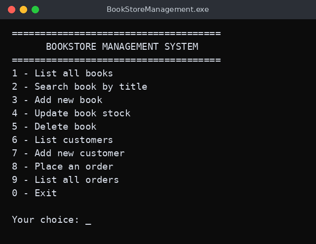
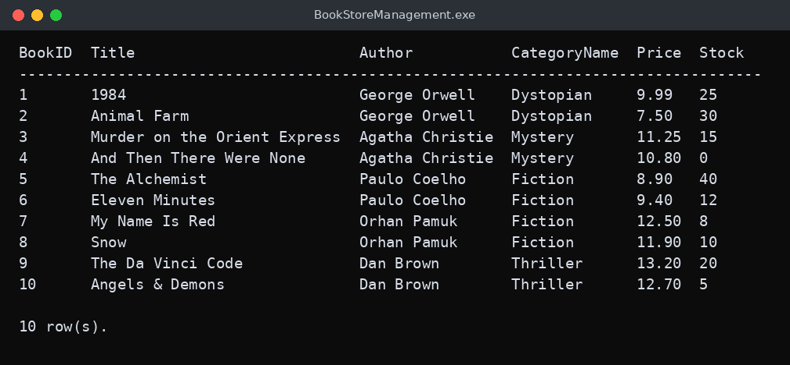
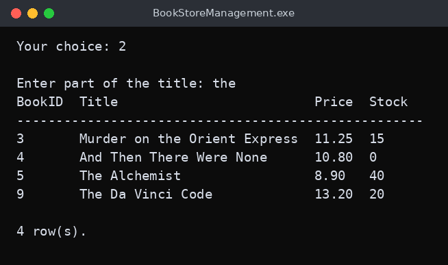
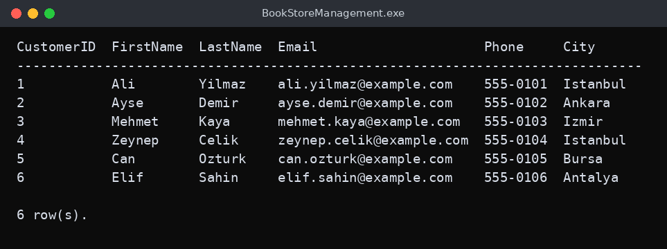
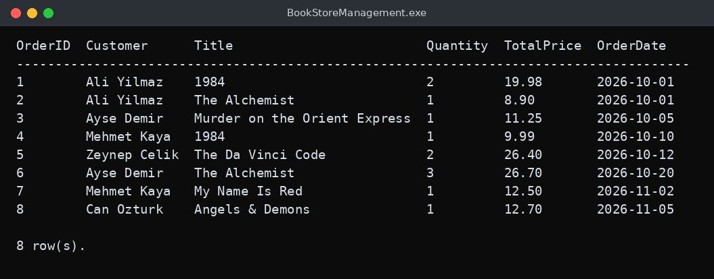
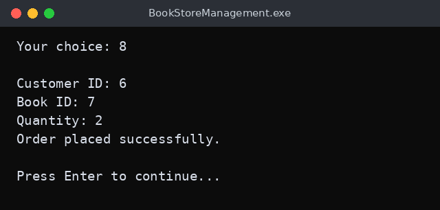
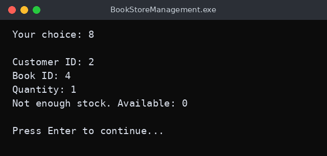
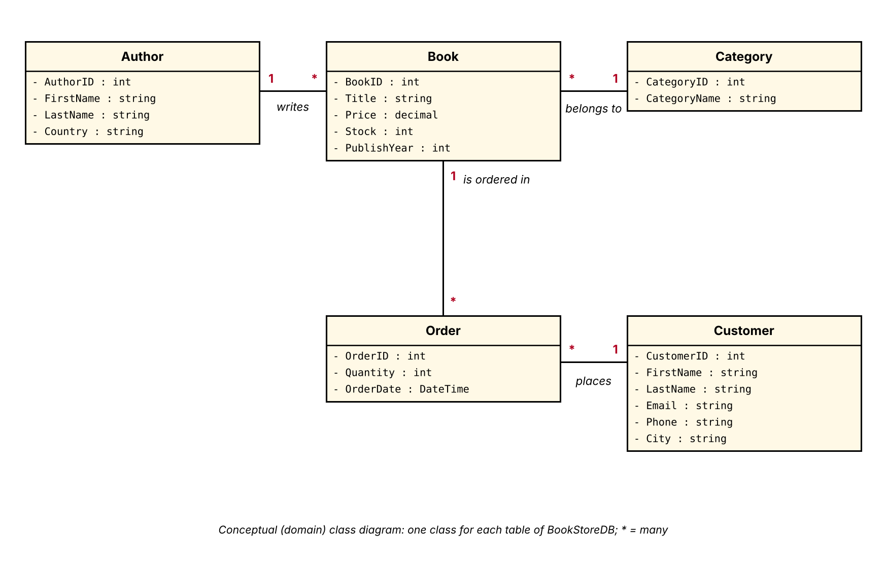
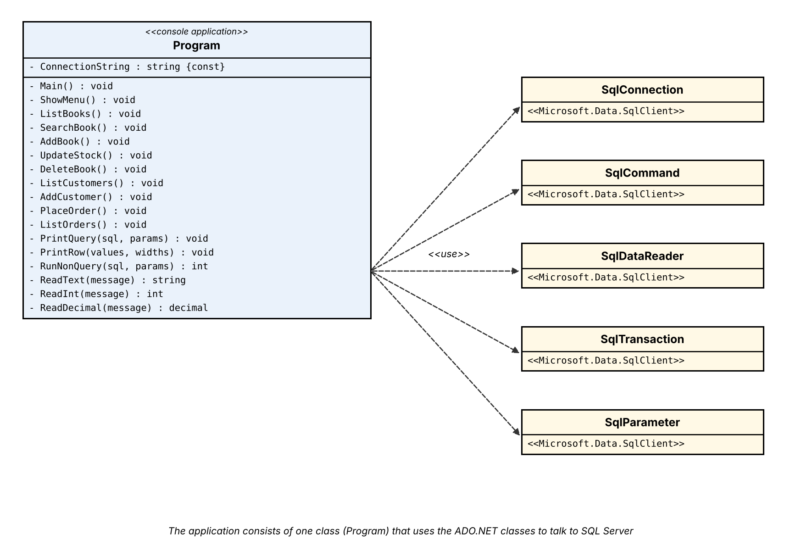

# BookStoreManagement

<h1 align="center">📚 BookStoreManagement</h1>

<p align="center">
  A simple bookstore management system built with <b>.NET 10</b> and <b>Microsoft SQL Server</b>.<br>
  A database course project: 5 tables, a console application and a full project report.
</p>

<p align="center">
  
  
  
  
</p>

<p align="center">
  
</p>

---

## ✨ Features

| Area | What you can do |
|------|-----------------|
| 📖 Books | List all books, search by title, add a book, update stock, delete a book |
| 👤 Customers | List customers, add a new customer |
| 🧾 Orders | Place an order (stock is checked and decreased in one transaction), list all orders with total price |
| 🛡️ Safety | Parameterized SQL commands, CHECK / UNIQUE / FOREIGN KEY constraints, friendly error messages |

## 🧰 Tech stack

- **C# / .NET 10** console application
- **Microsoft SQL Server** (LocalDB, Express or full instance) – database name: `BookStoreDB`
- **ADO.NET** with `Microsoft.Data.SqlClient`
- **T-SQL** for table creation and queries

## 🗂️ Project structure

```
BookStoreManagement/
├── BookStoreManagement.csproj
├── Program.cs                  # console application (menu + database code)
├── Database/
│   ├── BookStoreDB.sql         # creates BookStoreDB, 5 tables and sample data
│   └── Queries.sql             # 8 information retrieval queries
└── docs/images/                # diagrams and screenshots used in this README
```

## 🗄️ Database design

BookStoreDB has **5 tables**: `Authors`, `Categories`, `Books`, `Customers`, `Orders`.

- One author writes many books (1:N)
- One category contains many books (1:N)
- Customers and books are in a many-to-many relationship, which is stored in the `Orders` table

### ER diagram
<p align="center"></p>

### Relational schema
<p align="center"></p>

### Database diagram
<p align="center"></p>

The schema is in **Third Normal Form (3NF)**: every non-key column depends on the key, the whole key and nothing but the key.

| Table | Columns |
|-------|---------|
| `Authors` | **AuthorID**, FirstName, LastName, Country |
| `Categories` | **CategoryID**, CategoryName |
| `Books` | **BookID**, Title, *AuthorID*, *CategoryID*, Price, Stock, PublishYear |
| `Customers` | **CustomerID**, FirstName, LastName, Email, Phone, City |
| `Orders` | **OrderID**, *CustomerID*, *BookID*, Quantity, OrderDate |

(**bold** = primary key, *italic* = foreign key)

## 🚀 Getting started

### Requirements
- [.NET 10 SDK](https://dotnet.microsoft.com/download)
- Microsoft SQL Server (LocalDB comes with Visual Studio) and SQL Server Management Studio (SSMS)
- Visual Studio (recommended)

### Steps
1. **Create the database.** Open SSMS, connect to your server and run `Database/BookStoreDB.sql`.
   It creates `BookStoreDB`, the 5 tables and the sample data.
2. **Open the project.** Open `BookStoreManagement.csproj` in Visual Studio.
3. **Check the connection string** in `Program.cs`:
   ```csharp
   private const string ConnectionString =
       "Server=(localdb)\\MSSQLLocalDB;" +
       "Database=BookStoreDB;" +
       "Trusted_Connection=True;TrustServerCertificate=True;";
   ```
   For SQL Server Express use `.\\SQLEXPRESS` instead of `(localdb)\\MSSQLLocalDB`.
4. **Run** the project with `F5`, or from a terminal:
   ```bash
   dotnet restore
   dotnet run
   ```

## 🖥️ Screenshots

<table>
  <tr>
    <td align="center"><b>List all books</b><br></td>
    <td align="center"><b>Search by title</b><br></td>
  </tr>
  <tr>
    <td align="center"><b>Customers</b><br></td>
    <td align="center"><b>All orders</b><br></td>
  </tr>
  <tr>
    <td align="center"><b>Place an order</b><br></td>
    <td align="center"><b>Not enough stock</b><br></td>
  </tr>
</table>

## 🧩 Application design

<p align="center">
  
</p>
<p align="center">
  <br>
  
</p>

## 🔎 Example queries

All 8 queries are in [`Database/Queries.sql`](Database/Queries.sql):

1. All books with author and category (3-table `JOIN`)
2. Books cheaper than 10 (`WHERE`, `ORDER BY`)
3. Books that are out of stock or almost out of stock
4. Number of books and total stock per category (`GROUP BY`)
5. All orders with customer, book and total price (4-table `JOIN`)
6. Top 3 best-selling books (`SUM`, `GROUP BY`, `TOP`)
7. Customers who never ordered (`LEFT JOIN ... IS NULL`)
8. Total money spent per customer (`GROUP BY`, `HAVING`)

## 🛠️ Troubleshooting

| Problem | Solution |
|---------|----------|
| `NETSDK1004: project.assets.json not found` | Run `dotnet restore` in the project folder, then rebuild. Check that `nuget.org` is enabled in Visual Studio package sources. |
| `Cannot open database "BookStoreDB"` | Run `Database/BookStoreDB.sql` in SSMS first. |
| `A network-related or instance-specific error` | The server name in `ConnectionString` is wrong (LocalDB / `.\SQLEXPRESS` / your server). |
| Certificate error | Keep `TrustServerCertificate=True` in the connection string. |

## 📄 Project report

The full database project report (requirements, ER diagram, relational schema, normalization, SQL implementation, queries, UML diagrams and application screens) is available as [`docs/BookStoreManagement_Report.pdf`](docs/BookStoreManagement_Report.pdf).

---

<p align="center">Made as a database course project • .NET 10 + SQL Server</p>
