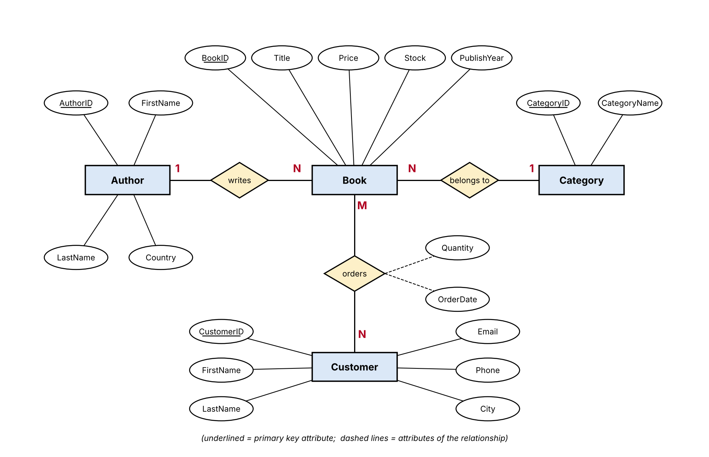
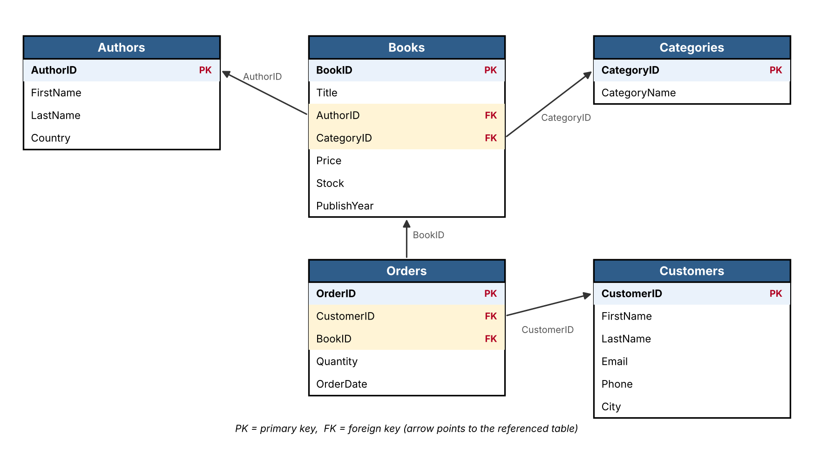
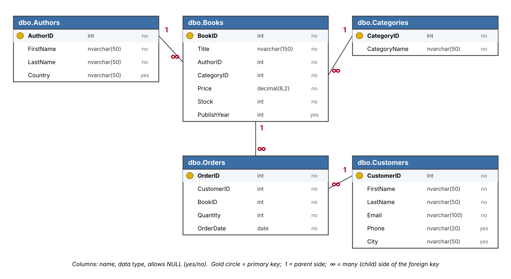
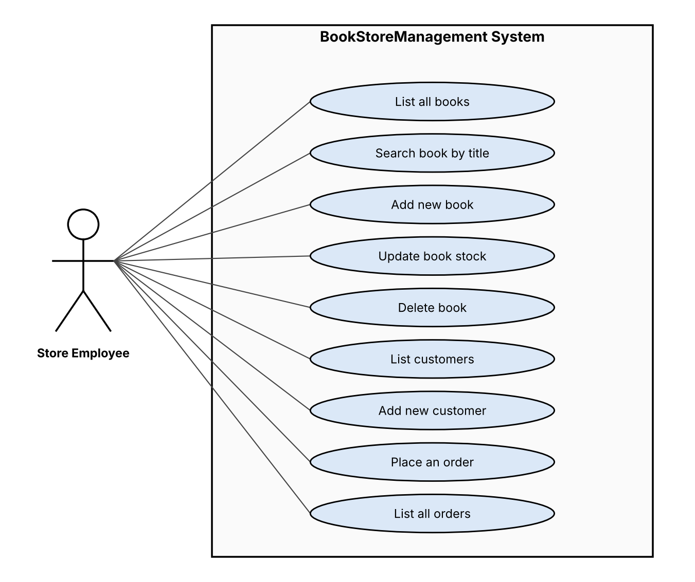

<h1 align="center">📚 BookStoreManagement</h1>

<p align="center">
  A modern desktop bookstore management system built with <b>.NET 10 (Windows Forms)</b> and <b>Microsoft SQL Server</b>.<br>
  A database course project: 5 tables, a clean multi-file code structure and a modern user interface.
</p>

<p align="center">
  
  
  
  
  
</p>

---

## ✨ Features

| Page | What you can do |
|------|-----------------|
| 🏠 **Dashboard** | Total books, customers, orders and revenue at a glance, latest orders, books that are almost out of stock |
| 📖 **Books** | Live search, add / edit / delete books, low stock is highlighted (orange = 5 or less, red = out of stock) |
| 👤 **Customers** | Live search, add / edit / delete customers, duplicate e-mails are rejected |
| 🧾 **Orders** | Choose customer + book + quantity, see the total price, stock is checked and decreased in one transaction, full order history |

The UI has a dark sidebar, flat buttons, card layout and clean tables.

## 🧰 Tech stack

- **C# / .NET 10** with **Windows Forms** (code-only UI, no designer files)
- **Microsoft SQL Server** (LocalDB, Express or full instance), database name: `BookStoreDB`
- **ADO.NET** with `Microsoft.Data.SqlClient` (parameterized commands, transaction for orders)
- **T-SQL** for the database script and queries

## 🗂️ Project structure

```
BookStoreManagement/
├── BookStoreManagement.csproj
├── Program.cs                      # entry point
├── Models/                         # one class for each table
│   ├── Author.cs
│   ├── Book.cs
│   ├── Category.cs
│   ├── Customer.cs
│   └── Order.cs
├── Data/                           # all SQL code (repository classes)
│   ├── Database.cs                 # connection string + helper methods
│   ├── BookRepository.cs
│   ├── CustomerRepository.cs
│   ├── OrderRepository.cs
│   └── LookupRepository.cs         # authors and categories
├── UI/
│   ├── MainForm.cs                 # window: sidebar + page area
│   ├── Theme.cs                    # colors, fonts, styles
│   ├── Dialogs.cs                  # message boxes
│   ├── Components/                 # CardPanel, StatCard
│   ├── Pages/                      # DashboardPage, BooksPage, CustomersPage, OrdersPage
│   └── Forms/                      # BookEditForm, CustomerEditForm
├── Database/
│   ├── BookStoreDB.sql             # creates BookStoreDB, 5 tables and sample data
│   └── Queries.sql                 # 8 information retrieval queries
└── docs/images/                    # diagrams used in this README
```

The code has three layers: **Models** (data classes) → **Data** (SQL code) → **UI** (windows). The UI never writes SQL; it only calls the repository classes.

## 🗄️ Database design

BookStoreDB has **5 tables**: `Authors`, `Categories`, `Books`, `Customers`, `Orders`.

- One author writes many books (1:N)
- One category contains many books (1:N)
- Customers and books are in a many-to-many relationship, which is stored in the `Orders` table

### ER diagram
<p align="center"></p>

### Relational schema
<p align="center"></p>

### Database diagram
<p align="center"></p>

The schema is in **Third Normal Form (3NF)**.

| Table | Columns |
|-------|---------|
| `Authors` | **AuthorID**, FirstName, LastName, Country |
| `Categories` | **CategoryID**, CategoryName |
| `Books` | **BookID**, Title, *AuthorID*, *CategoryID*, Price, Stock, PublishYear |
| `Customers` | **CustomerID**, FirstName, LastName, Email, Phone, City |
| `Orders` | **OrderID**, *CustomerID*, *BookID*, Quantity, OrderDate |

(**bold** = primary key, *italic* = foreign key)

## 🧩 Application design

<p align="center">
  
</p>
<p align="center">
  
</p>

The classes in the `Models` folder match this class diagram.

## 🚀 Getting started

### Requirements
- **Windows** (Windows Forms runs only on Windows)
- [.NET 10 SDK](https://dotnet.microsoft.com/download)
- Microsoft SQL Server (LocalDB comes with Visual Studio) and SQL Server Management Studio (SSMS)
- Visual Studio (recommended)

### Steps
1. **Create the database.** Open SSMS, connect to your server and run `Database/BookStoreDB.sql`.
   It creates `BookStoreDB`, the 5 tables and the sample data.
2. **Open the project.** Open `BookStoreManagement.csproj` in Visual Studio.
3. **Check the connection string** in `Data/Database.cs`:
   ```csharp
   public const string ConnectionString =
       "Server=(localdb)\\MSSQLLocalDB;" +
       "Database=BookStoreDB;" +
       "Trusted_Connection=True;TrustServerCertificate=True;";
   ```
   For SQL Server Express use `.\\SQLEXPRESS` instead of `(localdb)\\MSSQLLocalDB`.
4. **Run** the project with `F5`, or from a terminal:
   ```bash
   dotnet restore
   dotnet run
   ```

## 🔎 Example queries

All 8 queries are in [`Database/Queries.sql`](Database/Queries.sql):

1. All books with author and category (3-table `JOIN`)
2. Books cheaper than 10 (`WHERE`, `ORDER BY`)
3. Books that are out of stock or almost out of stock
4. Number of books and total stock per category (`GROUP BY`)
5. All orders with customer, book and total price (4-table `JOIN`)
6. Top 3 best-selling books (`SUM`, `GROUP BY`, `TOP`)
7. Customers who never ordered (`LEFT JOIN ... IS NULL`)
8. Total money spent per customer (`GROUP BY`, `HAVING`)

## 🛠️ Troubleshooting

| Problem | Solution |
|---------|----------|
| `NETSDK1004: project.assets.json not found` | Run `dotnet restore` in the project folder, then rebuild. Check that `nuget.org` is enabled in Visual Studio package sources. |
| "Database error" message when the app starts | Run `Database/BookStoreDB.sql` in SSMS first, then check the server name in `Data/Database.cs`. |
| `A network-related or instance-specific error` | The server name in `ConnectionString` is wrong (LocalDB / `.\SQLEXPRESS` / your server). |
| Certificate error | Keep `TrustServerCertificate=True` in the connection string. |

---

<p align="center">Made as a database course project • .NET 10 + SQL Server</p>
